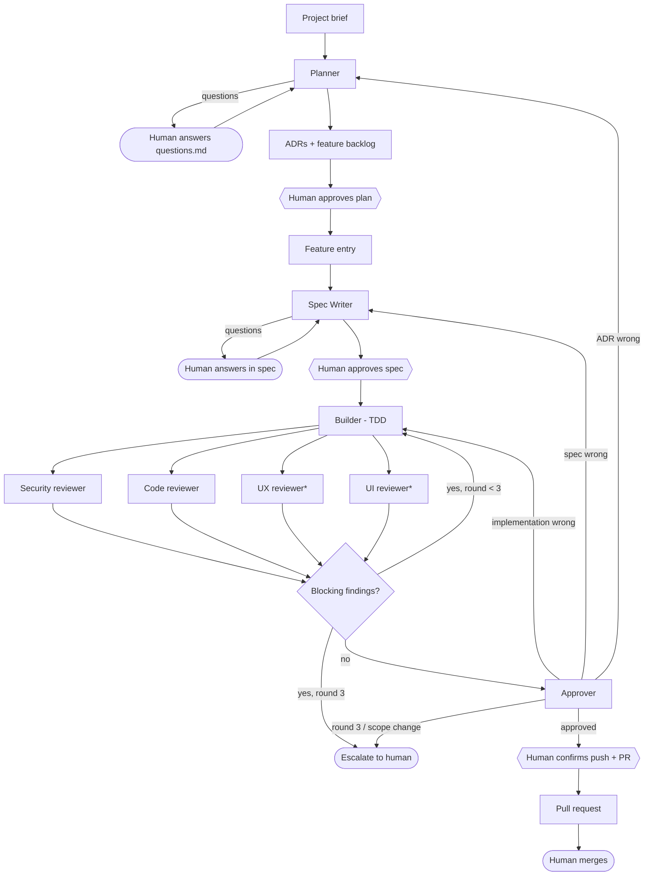

# saaf-software-factory

A software factory built on Claude Code agents. It takes a project brief, plans it into features, and runs each feature through a fixed pipeline (spec, test-driven build, parallel reviews, independent verification) until it is a pull request ready for a human to merge.

Agents do the work between stages. Humans approve the plan, approve each spec, confirm each pull request, and merge.

## Flow



\* UX and UI reviewers run only when the feature has `touches_frontend: true`.

### Two levels

| Level | Input | Agents | Output |
|---|---|---|---|
| Project | `brief.md` | Planner | ADRs, ordered backlog of feature entries |
| Feature | Feature entry | Spec Writer → Builder → 4 reviewers → Approver | Approved pull request |

Bugs and improvements on a delivered project skip the Planner: write a feature entry by hand in the project's `requests/` folder and run it through the feature pipeline.

### Stages

| Stage | Agent | Model | Reads | Writes |
|---|---|---|---|---|
| Planning | [planner](.claude/agents/planner.md) | Opus | `brief.md`, `context/` | `questions.md`, `plan/adr/`, `plan/backlog/`, `plan/README.md` |
| Spec | [spec-writer](.claude/agents/spec-writer.md) | Opus | Feature entry, ADRs, existing code | `specs/<id>-<slug>.md` |
| Build | [builder](.claude/agents/builder.md) | Opus | Approved spec, conventions | Code on `feature/<id>-<slug>`, `builds/<id>-<slug>.md` |
| Review | [security-reviewer](.claude/agents/security-reviewer.md) | Opus | Diff, spec | `reviews/<id>-<slug>/security.md` |
| Review | [code-reviewer](.claude/agents/code-reviewer.md) | Sonnet | Diff, spec, git log | `reviews/<id>-<slug>/code.md` |
| Review | [ux-reviewer](.claude/agents/ux-reviewer.md) | Sonnet | Running app, spec | `reviews/<id>-<slug>/ux.md` |
| Review | [ui-reviewer](.claude/agents/ui-reviewer.md) | Sonnet | Running app, spec | `reviews/<id>-<slug>/ui.md` |
| Approval | [approver](.claude/agents/approver.md) | Opus | Everything above, running app | `reviews/<id>-<slug>/approval.md` |

Paths in Reads and Writes are relative to the project folder `projects/<id>-<name>/`, except code, which goes to the project's own repository.

### Key rules

- **Test-driven development.** The Builder works one acceptance criterion at a time: failing test committed first (`test(F02): AC-3 ...`), then implementation (`feat(F02): AC-3 ...`). The Code reviewer checks this order in the git log.
- **Reviewers are read-only.** Only the Builder changes code. Reviewers and the Approver write only their findings files.
- **Blocking findings need evidence.** A finding blocks only if it has a concrete consequence and evidence someone else can check.
- **Independent verification.** The Approver does not rely on the Builder's tests alone: it checks each criterion against the running app.
- **Three rounds maximum.** After three fix rounds without convergence, the feature is escalated to a human.
- **All state lives in files.** Any run can be stopped and resumed.

## Repository structure

```
.
├── .claude/
│   ├── agents/              # one file per agent
│   └── skills/factory/      # the /factory command (orchestrator)
├── templates/
│   ├── project-brief.md     # input to the Planner
│   ├── feature-entry.md     # input to the feature pipeline
│   ├── spec.md              # Spec Writer output
│   ├── findings.md          # reviewer output
│   └── approval.md          # Approver output
├── policies/
│   ├── conventions.md       # stack options, structure, tooling, API rules, CI, Definition of done
│   └── review-process.md    # rules shared by all reviewers
└── projects/                # one folder per project (created by /factory new)
    └── <id>-<name>/
        ├── brief.md
        ├── context/
        ├── questions.md
        ├── plan/
        ├── requests/        # hand-written feature entries for bugs and improvements
        ├── specs/
        ├── builds/
        └── reviews/
```

The code of each project lives in its own repository, at the path given by `repo:` in its `brief.md`. This repository holds the factory and the records of what it produced.

## Supported stacks

Defined in [policies/conventions.md](policies/conventions.md), with selection criteria the Planner applies:

- **Backend**: Django + Django REST Framework, or FastAPI + SQLAlchemy + Alembic
- **Frontend**: Astro, React (Vite + TypeScript), or Angular
- **Shared**: PostgreSQL, Docker, uv / ruff / mypy / pytest, ESLint / Prettier / Vitest / Playwright

## Prerequisites

On the machine that runs the factory:

| Tool | Used by |
|---|---|
| [Claude Code](https://docs.claude.com/en/docs/claude-code) | Everything |
| git | Builder, reviewers, Approver |
| [GitHub CLI](https://cli.github.com/) (`gh`), authenticated | Opening pull requests |
| Docker and docker compose | Running apps and PostgreSQL for tests and reviews |
| [uv](https://docs.astral.sh/uv/) | Python projects |
| Node.js and npm | Frontend projects, Playwright, axe |
| Playwright browsers (`npx playwright install`) | UX and UI reviewers, Approver, end-to-end tests |
| Optional: `pip-audit`, `semgrep`, `bandit` | Security reviewer; skipped and reported if missing |

## Usage

Run these inside Claude Code, from the root of this repository.

### 1. Create a project

```
/factory new PRJ-001 customer-portal
```

Creates `projects/PRJ-001-customer-portal/` with a `brief.md` from the template. Fill in the brief, set `repo:` to where the code repository should live, and put supporting material in `context/`: meeting notes, API contracts (OpenAPI, schemas), design links. Prefer text over PDFs.

### 2. Plan it

```
/factory plan PRJ-001
```

The first run writes `questions.md`. Answer inline under each question and run the command again. The second run writes the ADRs and the backlog and asks you to approve the plan.

### 3. Build features

```
/factory PRJ-001/F00
/factory PRJ-001/F01
...
```

`F00` creates the project base: structure, tooling, CI, health endpoint. After that, each feature stops at the spec approval gate and before pushing. If it stops for questions or an escalation, answer where it tells you and run the same command again.

Features with no dependency between them can run in parallel from separate Claude Code sessions.

### 4. Check progress

```
/factory status PRJ-001
```

Shows every feature's stage, round, and who it is waiting on, and lists features ready to start.

### Bugs and improvements after delivery

Copy [templates/feature-entry.md](templates/feature-entry.md) to `projects/<project>/requests/REQ-0001-<slug>.md`, fill it in, and run:

```
/factory projects/<project>/requests/REQ-0001-<slug>.md
```

## Human gates

| Gate | Where | What you check |
|---|---|---|
| Discovery questions | `questions.md` | Answer the questions; object to listed assumptions |
| Plan approval | `plan/README.md` | Stack, ADRs, backlog order, risks |
| Spec clarification | Spec's Open questions | Answer inline |
| Spec approval | `specs/<id>-<slug>.md` | Acceptance criteria and the defaults the Spec Writer chose |
| Escalations | `approval.md` Decision section or command output | The question the factory could not resolve |
| Push and PR | Command prompt | PR description |
| Merge | Pull request | Final code review and merge |

Spec approval matters most: the acceptance criteria are what the Builder implements and what the Approver verifies.

## Status and what is missing

The agents, templates, policies and orchestrator are written. **Nothing has been run end to end yet.**

### Before the first real project

- [ ] **Run a pilot project.** A small FastAPI API with 2 or 3 features, to find where the prompts fail. Expect to adjust the agents.
- [ ] **Enforce permissions.** Agent boundaries (no push, no force, reviewers read-only) are only in the prompts. Add deny rules in `.claude/settings.json` for `git push`, `git reset --hard`, `git push --force` and similar, and allow the pushes the orchestrator needs only after confirmation.
- [ ] **Concrete CI configuration.** `policies/conventions.md` lists the CI stages but not the platform. Decide between GitHub Actions, Jenkins and Azure DevOps, and add a reference pipeline.
- [ ] **Review the conventions.** API error format, pagination and other defaults in `policies/conventions.md` are proposals. Replace them with your internal standards if you have them.
- [ ] **Design system location.** The UI reviewer assumes shared components in `frontend/src/shared/` and theme tokens. Confirm or define where each project's design system lives.

### Later

- [ ] **Intake validation agent.** A small Haiku agent that rejects incomplete entries before they reach the Spec Writer. Today the Spec Writer does this check itself, with a more expensive model.
- [ ] **Unattended orchestrator.** Port `/factory` to the Claude Agent SDK so the pipeline can run from a ticket, a schedule or CI, without an interactive session. The agent definitions in `.claude/agents/` can be reused as they are.
- [ ] **Second-opinion reviewer from another provider.** For example, an OpenAI model as an extra code or security reviewer, to reduce blind spots shared by builder and reviewer. Requires the Agent SDK orchestrator.
- [ ] **Scaffolds.** After 2 or 3 projects, extract a base project per stack from the best real one, so `F00` copies it instead of creating the base from scratch.
- [ ] **Deploy and operations stage.** Today the pipeline ends at the pull request. Deployment, monitoring and turning incidents into feature entries are not covered.
- [ ] **Factory metrics.** Lead time per stage, rounds per feature, findings per reviewer, escaped bugs, cost per feature, to see where the factory needs improving.
