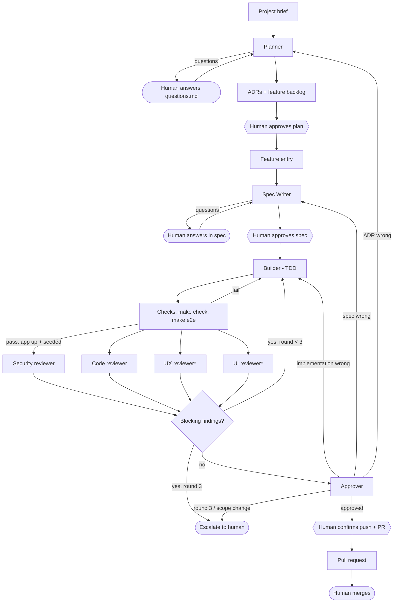
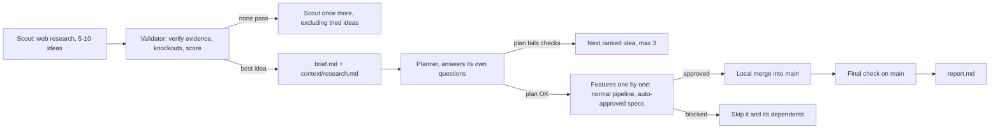

# saaf-software-factory

A software factory built on Claude Code agents. It takes a project brief, plans it into features, and runs each feature through a fixed pipeline (spec, test-driven build, parallel reviews, independent verification) until it is a pull request ready for a human to merge.

Agents do the work between stages. Humans approve the plan, approve each spec, confirm each pull request, and merge.

It also has an **autonomous mode** (`/factory auto`) that searches the web for a product idea, validates it, writes the brief, and builds its MVP locally with no human gates. See [Autonomous mode](#autonomous-mode).

## Flow



\* UX and UI reviewers run only when the feature has `touches_frontend: true`.

### Two levels

| Level | Input | Agents | Output |
|---|---|---|---|
| Project | `brief.md` | Planner | ADRs, ordered backlog of feature entries |
| Feature | Feature entry | Spec Writer → Builder → 4 reviewers → Approver | Approved pull request |

Bugs and improvements on a delivered project skip the Planner: write a feature entry by hand in the project's `requests/` folder and run it through the feature pipeline.

### Stages

| Stage | Agent | Model | Reads | Writes |
|---|---|---|---|---|
| Ideas (autonomous only) | [scout](.claude/agents/scout.md) | Sonnet | The web | `runs/<run>/ideas.md` |
| Validation (autonomous only) | [validator](.claude/agents/validator.md) | Opus | `ideas.md`, the web | `runs/<run>/validation.md`, `brief.md`, `context/research.md` |
| Planning | [planner](.claude/agents/planner.md) | Opus | `brief.md`, `context/` | `questions.md`, `plan/adr/`, `plan/backlog/`, `plan/README.md` |
| Spec | [spec-writer](.claude/agents/spec-writer.md) | Opus | Feature entry, ADRs, existing code | `specs/<id>-<slug>.md` |
| Build | [builder](.claude/agents/builder.md) | Opus | Approved spec, conventions | Code on `feature/<id>-<slug>` in the feature's worktree, `builds/<id>-<slug>.md` |
| Checks | Orchestrator (`make check`, `make e2e`) | n/a | Feature worktree | `builds/<id>-<slug>.checks.md` |
| Review | [security-reviewer](.claude/agents/security-reviewer.md) | Opus | Diff, spec | `reviews/<id>-<slug>/security.md` |
| Review | [code-reviewer](.claude/agents/code-reviewer.md) | Sonnet | Diff, spec, git log | `reviews/<id>-<slug>/code.md` |
| Review | [ux-reviewer](.claude/agents/ux-reviewer.md) | Sonnet | Running app, spec | `reviews/<id>-<slug>/ux.md` |
| Review | [ui-reviewer](.claude/agents/ui-reviewer.md) | Sonnet | Running app, spec | `reviews/<id>-<slug>/ui.md` |
| Approval | [approver](.claude/agents/approver.md) | Opus | Everything above, running app | `reviews/<id>-<slug>/approval.md` |
| Launch: demo | [demo-recorder](.claude/agents/demo-recorder.md) | Sonnet | Running MVP, specs, research | `launch/demo/` |
| Launch: landing | [landing-writer](.claude/agents/landing-writer.md) | Opus | Research, specs, demo assets | `launch/landing/` |

Paths in Reads and Writes are relative to the project folder `projects/<id>-<name>/`, except code, which goes to the project's own repository.

### Key rules

- **Test-driven development.** The Builder works one acceptance criterion at a time: failing test committed first (`test(F02): AC-3 ...`), then implementation (`feat(F02): AC-3 ...`). The Code reviewer checks this order in the git log.
- **Reviewers are read-only.** Only the Builder changes code. Reviewers and the Approver write only their findings files.
- **Blocking findings need evidence.** A finding blocks only if it has a concrete consequence and evidence someone else can check.
- **Independent verification.** The Approver does not rely on the Builder's tests alone: it checks each criterion against the running app.
- **One worktree and one environment per feature.** Each feature gets its own git worktree, branch, ports, containers and database, so features run in parallel without touching each other. The orchestrator runs the tests once and starts the app once per round; reviewers and the Approver use it but never start, stop or reseed it.
- **Three rounds maximum.** After three fix rounds without convergence, the feature is escalated to a human.
- **All state lives in files.** Any run can be stopped and resumed.

## Repository structure

```
.
├── .claude/
│   ├── agents/              # one file per agent
│   └── skills/factory/      # the /factory command (orchestrator)
├── templates/
│   ├── project-brief.md     # input to the Planner
│   ├── feature-entry.md     # input to the feature pipeline
│   ├── spec.md              # Spec Writer output
│   ├── findings.md          # reviewer output
│   └── approval.md          # Approver output
├── policies/
│   ├── conventions.md       # stack options, structure, tooling, API rules, CI, Definition of done
│   └── review-process.md    # rules shared by all reviewers
└── projects/                # one folder per project (created by /factory new)
    └── <id>-<name>/
        ├── brief.md
        ├── context/
        ├── questions.md
        ├── plan/
        ├── requests/        # hand-written feature entries for bugs and improvements
        ├── specs/
        ├── builds/
        ├── reviews/
        └── launch/          # demo video and Carrd-ready landing page
            ├── demo/
            └── landing/
examples/                    # finished example projects, versioned
└── lesson-ledger/
    ├── project/             # what the factory writes in projects/<id>-<name>/
    └── output/              # the code it builds in workspaces/<name>/
runs/                        # one folder per autonomous run
└── RUN-<date>-<n>/
    ├── run.md               # state, budget and log
    ├── ideas.md             # Scout output
    ├── validation.md        # Validator output
    └── report.md            # final report
workspaces/                  # git-ignored
├── <name>/                  # main checkout of each project, always on the base branch
├── .worktrees/
│   └── <name>/
│       └── <id>-<slug>/     # one worktree per feature in progress
└── .slots.md                # port slots assigned to features on this machine
```

The code of each project lives in its own git repository under `workspaces/<name>/`, set by `repo:` in its `brief.md`. `workspaces/` is inside this folder so Claude Code can write to it without extra permissions, and git-ignored so project code never ends up in the factory's history. This repository holds the factory and the records of what it produced.

## Supported stacks

Defined in [policies/conventions.md](policies/conventions.md), with selection criteria the Planner applies:

- **Backend**: Django + Django REST Framework, or FastAPI + SQLAlchemy + Alembic
- **Frontend**: Astro, React (Vite + TypeScript), or Angular
- **Shared**: PostgreSQL, Docker, uv / ruff / mypy / pytest, ESLint / Prettier / Vitest / Playwright

## Prerequisites

On the machine that runs the factory:

| Tool | Used by |
|---|---|
| [Claude Code](https://docs.claude.com/en/docs/claude-code) | Everything |
| git | Builder, reviewers, Approver |
| make | Orchestrator and Builder; every project exposes standard targets |
| [GitHub CLI](https://cli.github.com/) (`gh`), authenticated | Opening pull requests |
| Docker and docker compose | Running apps and PostgreSQL for tests and reviews |
| [uv](https://docs.astral.sh/uv/) | Python projects |
| Node.js and npm | Frontend projects, Playwright, axe |
| Playwright browsers (`npx playwright install`) | UX and UI reviewers, Approver, end-to-end tests, demo video |
| ffmpeg (includes ffprobe) | Demo video export (MP4, voice-over mix, GIF, poster); without it the demo stays as silent WebM with no GIF |
| Optional: `ELEVENLABS_API_KEY` | Only for `/factory launch <project> voice=elevenlabs` |
| Optional: `pip-audit`, `semgrep`, `bandit` | Security reviewer; skipped and reported if missing |

## Usage

Run these inside Claude Code, from the root of this repository.

### 1. Create a project

```
/factory new PRJ-001 customer-portal
```

Creates `projects/PRJ-001-customer-portal/` with a `brief.md` from the template, with `repo: workspaces/customer-portal`. Fill in the brief and put supporting material in `context/`: meeting notes, API contracts (OpenAPI, schemas), design links. Prefer text over PDFs.

For a new project, `F00` creates the repository. For an existing codebase, clone it into `workspaces/customer-portal` before planning.

### 2. Plan it

```
/factory plan PRJ-001
```

The first run writes `questions.md`. Answer inline under each question and run the command again. The second run writes the ADRs and the backlog and asks you to approve the plan.

### 3. Build features

```
/factory PRJ-001/F00
/factory PRJ-001/F01
...
```

`F00` creates the project base: structure, tooling, CI, health endpoint. After that, each feature stops at the spec approval gate and before pushing. If it stops for questions or an escalation, answer where it tells you and run the same command again.

Features with no dependency between them can run in parallel, each from its own Claude Code session. Each one gets its own worktree under `workspaces/.worktrees/` and its own port slot, recorded in `workspaces/.slots.md`: slot `N` uses ports `8100+N` (backend), `3100+N` (frontend), `5500+N` (PostgreSQL) and `6400+N` (Redis). `F00` cannot run in parallel with anything: every other feature starts from it.

### Clean up after merging

```
/factory cleanup PRJ-001
```

For every feature whose pull request is merged: stops its containers, removes its worktree and local branch, updates the main checkout and frees its slot. Worktrees with uncommitted changes are reported and left alone.

### 4. Check progress

```
/factory status PRJ-001
```

Shows every feature's stage, round, and who it is waiting on, and lists features ready to start.

### 5. Demo video and landing page

```
/factory launch PRJ-001                     # local voice-over (default)
/factory launch PRJ-001 voice=none          # captions only
/factory launch PRJ-001 voice=elevenlabs    # ElevenLabs voice, needs ELEVENLABS_API_KEY
```

Prepares what you need to test the idea with real people, in `projects/PRJ-001-<name>/launch/`. Nothing is published.

- **Demo video** (`demo/`): the Demo recorder writes a storyboard with narration, generates the voice-over, then scripts the main user flow with Playwright against the seeded app, pacing each scene to its narration. Output: a 45-90 second `demo.mp4` with voice-over and burned-in captions (so it works muted), `demo.vtt` and `demo.srt` subtitle files (for YouTube or Vimeo, and for translations), a short silent `demo.gif` for the hero section, `poster.png`, screenshots, and the storyboard in `script.md`. Narration and captions use the target users' language.

  | `voice` | Engine | Leaves the machine |
  |---|---|---|
  | `local` (default) | [Piper](https://github.com/rhasspy/piper) neural text-to-speech, falling back to macOS `say` | No |
  | `none` | Captions only | No |
  | `elevenlabs` | ElevenLabs API; asks for confirmation first, never used by `/factory auto` | The narration text |
- **Landing page** (`landing/`): the Landing writer turns the research and the built features into a page for one audience with one call to action (sign-up at a stated early access price). Carrd has no HTML import, so the output is:
  - `carrd.md`: a section-by-section build guide, with the exact copy and the Carrd element and settings for each part, site metadata, form setup, what to measure, how the price was chosen, and a to-do list before publishing (privacy policy, contact, domain, video upload, analytics).
  - `preview.html`: the same page as a self-contained HTML file, to review copy and layout in a browser before building it in Carrd.

The copy never includes invented testimonials, user counts, logos or statistics, and only describes features that were built.

`/factory auto` runs this automatically at the end of a run.

### Bugs and improvements after delivery

Copy [templates/feature-entry.md](templates/feature-entry.md) to `projects/<project>/requests/REQ-0001-<slug>.md`, fill it in, and run:

```
/factory projects/<project>/requests/REQ-0001-<slug>.md
```

## Autonomous mode

```
/factory auto
/factory auto "tools for independent music teachers" max_features=6
/factory auto resume RUN-2026-11-16-1
```



**How it differs from the normal flow:**

| Normal gate | In autonomous mode |
|---|---|
| Brief written by a person | The Validator writes it for the best idea that survives |
| Discovery questions | The Planner answers them from the research and the conventions |
| Plan approval | Automatic if it fits the feature limit, uses the approved stack and needs no external services |
| Spec questions and approval | The Spec Writer decides, marking each choice `Autonomous decision:`; the orchestrator approves |
| Escalations | The feature is marked blocked, with everything that depends on it; the run continues |
| Push, PR and merge | Local merge into the project's `main`; nothing leaves the machine |

**Idea validation.** The Scout looks for people describing a problem themselves (forums, product reviews, unanswered "is there a tool for…" questions) and needs at least 3 sources per idea. The Validator tries to reject each idea: it opens every source, searches for competitors itself, and applies knockout criteria before scoring:

- Knockouts: outside the factory stack, MVP larger than the feature limit, regulated or sensitive domain (health, finance, legal, children, sensitive data…), needs paid services or third-party accounts, cannot be shown locally with synthetic data, clone of an existing product.
- Scores (1-5, weighted): problem severity ×3, willingness to pay ×3, audience size ×2, competition gap ×2. Passing needs 3.5 and no knockout; any score above 3 needs two sources the Validator opened.

This is desk research. It filters out weak ideas; it cannot show that an idea will succeed. The report says so and recommends talking to real users before going further.

**Guardrails.** Local only: no push, no remote repositories, no deploy, no accounts, no emails, no payments. Budget per run: `max_features` (8), `max_ideas` (3), `max_agents` (150) agent launches. When a limit is reached the run stops cleanly and writes its report.

**Result.** `runs/<run>/report.md` with the selected idea and the strongest argument against it, the rejected ideas, the status of every feature, the final check, the launch kit (demo video and Carrd-ready landing page, see [step 5](#5-demo-video-and-landing-page)), the decisions taken without a human, and how to run the MVP.

**Running it unattended.** Inside Claude Code, every permission prompt pauses the run. Allow `make`, `git`, `docker`, `uv`, `npm`/`npx` and the web tools in `.claude/settings.json` (and deny `git push` and `gh`) before starting a long run. For runs that must survive closing the editor, see the Agent SDK item under [What is missing](#status-and-what-is-missing).

## Human gates

| Gate | Where | What you check |
|---|---|---|
| Discovery questions | `questions.md` | Answer the questions; object to listed assumptions |
| Plan approval | `plan/README.md` | Stack, ADRs, backlog order, risks |
| Spec clarification | Spec's Open questions | Answer inline |
| Spec approval | `specs/<id>-<slug>.md` | Acceptance criteria and the defaults the Spec Writer chose |
| Escalations | `approval.md` Decision section or command output | The question the factory could not resolve |
| Push and PR | Command prompt | PR description |
| Merge | Pull request | Final code review and merge |

Spec approval matters most: the acceptance criteria are what the Builder implements and what the Approver verifies.

## Status and what is missing

The agents, templates, policies and orchestrator are written. **Nothing has been run end to end yet.**

### Before the first real project

- [ ] **Run a pilot project.** A small FastAPI API with 2 or 3 features, to find where the prompts fail. Expect to adjust the agents.
- [ ] **Enforce permissions.** Agent boundaries (no push, no force, reviewers read-only) are only in the prompts. Add deny rules in `.claude/settings.json` for `git push`, `git reset --hard`, `git push --force` and similar, and allow the pushes the orchestrator needs only after confirmation.
- [ ] **Concrete CI configuration.** `policies/conventions.md` lists the CI stages but not the platform. Decide between GitHub Actions, Jenkins and Azure DevOps, and add a reference pipeline.
- [ ] **Review the conventions.** API error format, pagination and other defaults in `policies/conventions.md` are proposals. Replace them with your internal standards if you have them.
- [ ] **Design system location.** The UI reviewer assumes shared components in `frontend/src/shared/` and theme tokens. Confirm or define where each project's design system lives.

### Later

- [ ] **Intake validation agent.** A small Haiku agent that rejects incomplete entries before they reach the Spec Writer. Today the Spec Writer does this check itself, with a more expensive model.
- [ ] **Unattended orchestrator.** Port `/factory` and especially `/factory auto` to the Claude Agent SDK, so a run survives closing the editor and can be started from a schedule or CI, with budget and routing enforced in code instead of in a prompt. The agent definitions in `.claude/agents/` can be reused as they are.
- [ ] **Market validation step.** The autonomous mode validates ideas with desk research only. A later step could test demand for real (landing page, waitlist), which needs a budget, accounts and a human decision.
- [ ] **Second-opinion reviewer from another provider.** For example, an OpenAI model as an extra code or security reviewer, to reduce blind spots shared by builder and reviewer. Requires the Agent SDK orchestrator.
- [ ] **Scaffolds.** After 2 or 3 projects, extract a base project per stack from the best real one, so `F00` copies it instead of creating the base from scratch.
- [ ] **Deploy and operations stage.** Today the pipeline ends at the pull request. Deployment, monitoring and turning incidents into feature entries are not covered.
- [ ] **Factory metrics.** Lead time per stage, rounds per feature, findings per reviewer, escaped bugs, cost per feature, to see where the factory needs improving.
