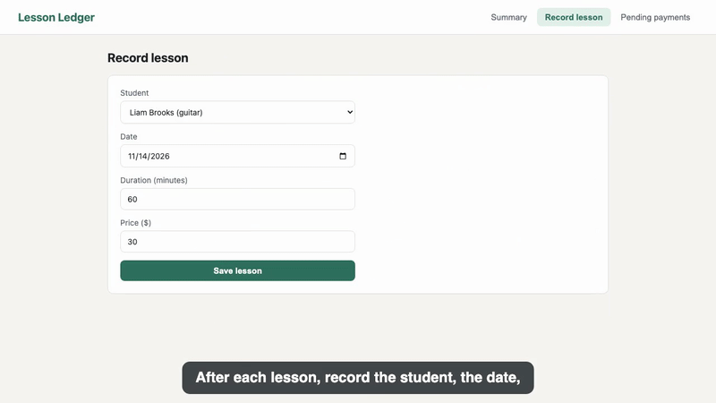

# Example: Lesson Ledger

A small example of what the factory produces. Lesson Ledger is a single-page app where an independent music teacher records lessons, sees a monthly summary, and marks pending payments as paid.



Full video with voice-over and captions: [demo.mp4](project/launch/demo/demo.mp4).

## Layout

| Folder | In a real run it lives in | Contents |
|---|---|---|
| [project/](project/) | `projects/PRJ-900-lesson-ledger/` | Brief, research, plan, spec and launch kit |
| [output/](output/) | `workspaces/lesson-ledger/` (its own git repository) | The app's code |

The `repo:` field in [project/brief.md](project/brief.md) still points to `workspaces/lesson-ledger`, as it would in a real run.

## What each file is

- [project/brief.md](project/brief.md): input to the Planner.
- [project/context/research.md](project/context/research.md): supporting research. Its quotes are illustrative.
- [project/plan/README.md](project/plan/README.md): Planner output, with a backlog of F00 and F01.
- [project/specs/F01-lessons-and-payments.md](project/specs/F01-lessons-and-payments.md): Spec Writer output, with acceptance criteria AC-1 to AC-4.
- [project/launch/demo/](project/launch/demo/): Demo Recorder output.
  - Video, GIF and poster.
  - VTT and SRT subtitles.
  - Screenshots.
  - [script.md](project/launch/demo/script.md), the storyboard with timings.
- [output/](output/): the app.

## Simplifications

This example is trimmed to show the shape of each artifact, not a full run:

- The app is a static HTML page with data in localStorage. A real project uses one of the stacks in [policies/conventions.md](../../policies/conventions.md), and comes with tests, a Makefile and Docker Compose.
- There are no build reports, reviews, approvals, or landing page.
- The code's git history was dropped when the code was copied here. In the original repository it was:

  ```
  *   F01: Lessons and payments
  |\
  | * feat(F01): lessons and payments
  |/
  *   F00: Project base
  |\
  | * feat(F00): project base
  |/
  * Initial commit
  ```

## Run the app

```bash
cd examples/lesson-ledger/output && python3 -m http.server 8791
```

Open http://localhost:8791 and log in with `teacher@example.com` / `demo1234`. Any email and password work.
