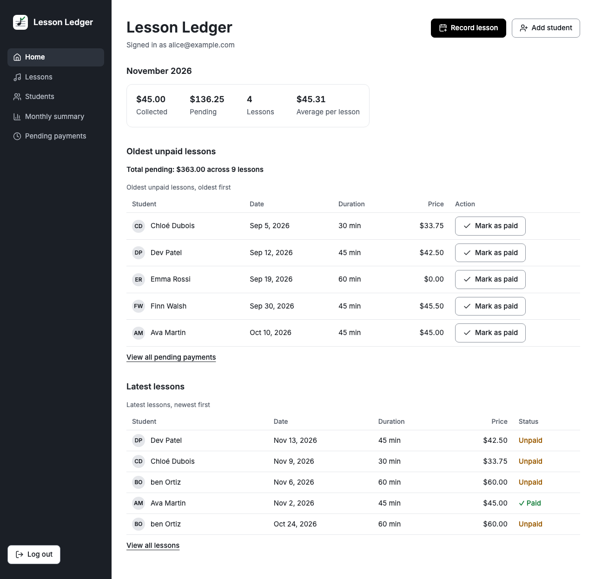

# Example: Lesson Ledger

The factory's pilot project, kept as a complete example of a real run. Lesson Ledger lets an independent music teacher record students and lessons, see a monthly summary, and mark pending lessons as paid.



The project was created by hand with `/factory new` to test the pipeline end to end. The idea itself was never validated: [project/context/research.md](project/context/research.md) is an illustrative fixture, not real research.

## Run at a glance

| | |
|---|---|
| Features | 10 (F00 to F09), all merged |
| Acceptance criteria | 60 (6 per feature) |
| Agent runs | 115 |
| Tokens | 7,380,220, excluding the orchestrator's own |
| Features that passed in round 1 | 6 of 10 |
| Blocking findings | 11: 7 defects, 4 test gaps, 0 noise |
| Escaped defects | 5 |
| App code | 318 files; 323 backend, 493 frontend and 276 end-to-end tests at the end |

What went well and what to change in the factory: [RETROSPECTIVE.md](RETROSPECTIVE.md).

## Layout

| Folder | In a real run it lives in | Contents |
|---|---|---|
| [project/](project/) | `projects/PRJ-001-lesson-ledger/` | Everything the agents and the orchestrator wrote |
| [output/](output/) | `workspaces/lesson-ledger/` (its own git repository) | The app's code at the last commit of `main` |
| [git-history.txt](git-history.txt) | `git log --graph` of that repository | 207 lines: one merge per feature, with the builder's `test(...)` and `feat(...)` commits |

Paths inside the project files still read `projects/PRJ-001-lesson-ledger/...` and `workspaces/lesson-ledger`, as they did during the run.

## What each part of `project/` is

- [brief.md](project/brief.md) and [context/](project/context/): the input, including the owner's design direction for the redesign (F06).
- [questions.md](project/questions.md): the Planner's discovery questions and the answers.
- [plan/](project/plan/): the Planner's output. [README.md](project/plan/README.md) has the backlog and the history of 5 revisions. [adr/](project/plan/adr/) has ADR-001 to ADR-008, and [backlog/](project/plan/backlog/) has the feature entries.
- [specs/](project/specs/): one approved spec per feature, with acceptance criteria AC-1 to AC-6.
- [builds/](project/builds/): the Builder's report per feature (`<id>-<slug>.md`) and the orchestrator's check results (`.checks.md`).
- [reviews/](project/reviews/): per feature, the four reviewers' findings files and `approval.md`, with the owner's approval appended.
- [usage.md](project/usage.md): tokens, tool uses and duration of every agent run.
- [metrics.md](project/metrics.md): per-feature results, reviewer precision, escaped defects, interventions and human gates.
- [pilot-notes.md](project/pilot-notes.md): process problems found during the run, numbered 1 to 17.

## Feature history

| Feature | Rounds | Tokens | Notes |
|---|---|---|---|
| F00 Project base | 3 | 647,165 | Security reviewer found the database reachable from the LAN |
| F01 Teacher accounts | 1 | 467,529 | |
| F02 Students and lessons | 3 | 829,096 | Table overflowed at 375 px |
| F03 Monthly summary and payments | 1 | 469,914 | A mark/undo race escaped and was found in F05 |
| F04 Visual identity foundation | 1 | 559,991 | Look rejected by the owner after merge |
| F05 Restyle remaining pages | 4 | 1,183,619 | E2E infrastructure, the F03 race, coverage |
| F06 Dashboard redesign | 3 | 1,003,926 | Replaced the F04/F05 look; first screenshot gate |
| F07 Home overview | 1 | 616,689 | Home had stayed an empty placeholder since F01 |
| F08 Icons, brand and motion | 1 | 650,667 | |
| F09 Branded sign-in pages | 1 | 619,139 | |

Planning and its 5 revisions used another 332,485 tokens.

## Run the app

Needs Docker with Compose v2, uv, Node.js, npm and GNU Make (see [output/README.md](output/README.md)).

```bash
cd examples/lesson-ledger/output
cp .env.example .env
make install && make up && make seed
```

Open http://localhost:3000. The seed accounts are below; [output/README.md](output/README.md) lists which account reaches each screen state.

| Email | Password | Data |
|---|---|---|
| alice@example.com | alice-ledger-pass | 6 students and 12 lessons over three months, 9 unpaid |
| bob@example.com | bob-ledger-pass1 | No students or lessons, for the empty states |
| carol@example.com | carol-ledger-pass | 510 students and 520 unpaid lessons, for long lists |

`make down` removes the containers and the database volume.

Screenshots of every page at 375 and 1280 px, as approved at each visual gate, are in [output/docs/design/](output/docs/design/).
